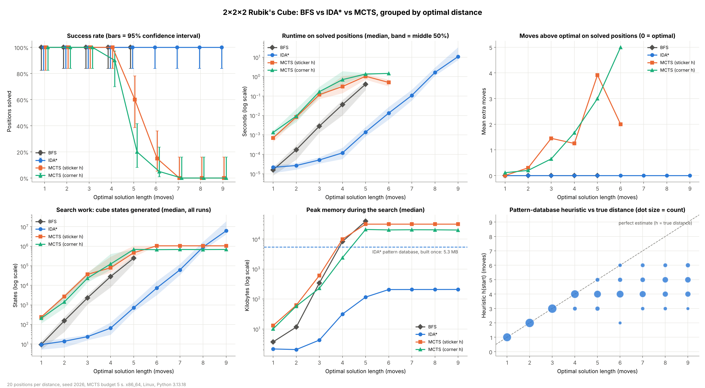

# A Comparative Analysis of Heuristic and Pattern Database Search Algorithms for Optimal Solving of the Rubik's Cube State Space

Hannah Huang, Friends Academy. ISEF category: Systems Design / Algorithm. Presented at LISEF and ISEF.

This project measures how much each step up in search strategy helps when solving the 2x2x2 Rubik's Cube (Pocket Cube) in Python. It compares breadth-first search (BFS), IDA* guided by pattern databases, and Monte Carlo Tree Search (MCTS) on the same cube positions. The 2x2x2 is the pilot puzzle because its full state space can be searched, so every solver's answer can be checked against the true shortest solution. The next step is the 3x3x3 cube.

## Research question

Do more advanced search methods (BFS, then A* and IDA*, then pattern-database IDA*, then MCTS, and later reinforcement learning) solve the cube more efficiently? Efficiency is measured three ways: accuracy (how often a solver finds a solution, and whether it is the shortest one), run time, and memory use.

## Results

The benchmark tested 178 cube positions, 20 at each optimal distance from 1 to 9 moves (only 18 positions are 1 move from solved). Positions are grouped by their true optimal distance, which IDA* finds and BFS confirms up to distance 5. Grouping by scramble length would be misleading, because a 7-move scramble can be only 4 moves from solved.

| Optimal distance | Solver | Solved | Median time (solved runs) | Median peak memory |
|---|---|---|---|---|
| 5 moves | BFS | 20 of 20 | 0.41 s | 38 MB |
| 5 moves | IDA* | 20 of 20 | 0.0014 s | 0.11 MB |
| 5 moves | MCTS, sticker heuristic | 12 of 20 | 1.05 s | 31 MB |
| 5 moves | MCTS, corner heuristic | 4 of 20 | 1.36 s | 20 MB |
| 9 moves | IDA* | 20 of 20 | 10.7 s | 0.20 MB |
| 9 moves | MCTS, either heuristic | 0 of 20 | (none solved) | 20 to 31 MB |

Findings so far:

1. IDA* solved all 178 positions, and every solution was optimal. BFS agreed with IDA* on the optimal length of every position it ran on (distances 1 to 5).
2. BFS also finds optimal solutions, but at distance 5 it already used about 340 times more memory than IDA*. It was not run past distance 5 because its visited set grows into the millions of states.
3. MCTS solved every position up to 4 moves, then dropped to 12 of 20 at 5 moves, 3 of 20 at 6, and none from 7 to 9 within a 5-second budget. When it did solve a position, its solutions averaged up to about 4 moves longer than optimal.
4. Heuristic quality drives IDA*'s speed. The corner-permutation pattern database ignores orientation, so it underestimates more as positions get harder (graph 6), and IDA*'s work grows quickly after distance 7. Adding a second pattern database for corner orientation and taking the larger of the two values cut the search for the sample scramble `R U R2 F D F2 U` from 3,126 nodes to 70 nodes, with the same 6-move optimal solution.

All six graphs, the summary table, and the raw CSV data are in [`cube_solver/isef_results/`](cube_solver/isef_results/). The graphs in this repository come from a test run on a Windows computer. 



## Repository layout

| Path | Contents |
|---|---|
| `isef_rubiks_cube.py` | The whole benchmark project in one file (cube model, IDA*, both MCTS versions, BFS, benchmark, graphs). Runs by itself. |
| `cube_solver/rubiks_cube_analysis.py` | 24-sticker cube model, the corner-permutation pattern database (BFS over all 40,320 corner permutations), and the IDA* solver. |
| `cube_solver/rubiks_cube_mcts.py` | MCTS with UCT selection and random rollouts, sticker-count rollout heuristic. |
| `cube_solver/rubiks_cube_mcts_improved_heuristic.py` | The same MCTS with a corner-aware rollout heuristic. |
| `cube_solver/isef_benchmark.py` | Benchmark of BFS, IDA*, and both MCTS versions; writes CSV files and six graphs. |
| `cube_solver/isef_results/` | Benchmark output: `summary.txt`, `summary.csv`, `cases.csv`, `memory.csv`, and the graphs. |
| `standalone_solvers/cube2x2_bfs.py` | A `Cube` class (corner permutation and orientation) and a BFS solver with tests. |
| `standalone_solvers/cube2x2_ida.py` | IDA* with two pattern databases (corner permutation and corner orientation) combined with `max`. |
| `graph_search_basics/` | BFS, DFS, and A* on small graphs and a grid: the starting point before the cube. The BFS and DFS examples are adapted from GeeksforGeeks (credited in the files). |
| `docs/research_sources.md` | Annotated bibliography. |

## How to run

Python 3.8 or newer.

```bash
pip install -r requirements.txt

# All-in-one file
python isef_rubiks_cube.py --demo      # solve one cube with IDA*, under a second
python isef_rubiks_cube.py --quick     # small benchmark, about 2 minutes
python isef_rubiks_cube.py             # full benchmark, about 45 minutes
python isef_rubiks_cube.py --replot    # redraw graphs from a finished run

# Same benchmark from the separate modules
cd cube_solver
python isef_benchmark.py --quick
python rubiks_cube_analysis.py         # IDA* example solve and pattern database plots

# Standalone solvers (standard library only)
python standalone_solvers/cube2x2_bfs.py
python standalone_solvers/cube2x2_ida.py
```

## Method

- Cube model: 24 stickers (8 corners, 3 stickers each) and 18 moves (each of the 6 faces turned clockwise, counterclockwise, or 180 degrees).
- IDA* uses an admissible heuristic (it never overestimates the remaining moves), so its first solution is always a shortest one. Move pruning skips turning the same face twice in a row and keeps only one order for opposite faces, which commute.
- MCTS uses UCT with exploration constant sqrt(2), random rollouts of 20 moves, and a budget of 5 seconds or 50,000 iterations per position.
- Statistics: success rates carry 95% Wilson confidence intervals. Runtime is reported for solved runs only, because a failed MCTS run always lasts its full time limit. Search work is counted as cube states generated, including MCTS rollout states. Peak memory is measured with Python's `tracemalloc` in a separate, untimed rerun of the identical search.
- Every random choice is seeded (seed 2026), so the benchmark is reproducible.

Limitations: IDA* has no time limit, and 20 of its 178 solves took longer than the 5 seconds MCTS received (the slowest took 74 seconds). The sticker-heuristic MCTS reached its 50,000-iteration cap in about 3.9 seconds, while the slower corner heuristic ran the full 5 seconds at about 32,500 iterations, so the two MCTS versions did not search equal amounts. `tracemalloc` does not count Python's recursion stack, so IDA*'s search memory reads slightly low.

## Roadmap

- [x] BFS solver and full state-space map (3,674,160 positions, God's number 11 in the half-turn metric)
- [x] IDA* with pattern-database heuristics
- [x] MCTS with two rollout heuristics
- [x] Benchmark of BFS, IDA*, and MCTS grouped by optimal distance, with confidence intervals and memory
- [ ] A* with a priority queue and a node-count comparison against IDA*
- [ ] Combined permutation and orientation pattern database in the main benchmark
- [ ] Learned heuristic (reinforcement learning), following DeepCubeA
- [ ] Extend to the 3x3x3 cube

## Key sources

The full annotated list is in [`docs/research_sources.md`](docs/research_sources.md). The core references are Hart, Nilsson, and Raphael (1968) for A*; Korf (1985) for IDA*; Culberson and Schaeffer (1998) and Korf (1997) for pattern databases; Kocsis and Szepesvari (2006) and Browne et al. (2012) for Monte Carlo Tree Search; and Agostinelli et al. (2019) for learned heuristics.
